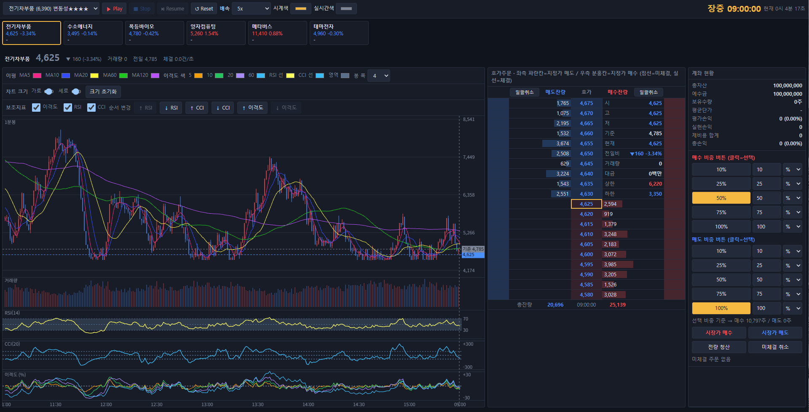

# 스캘핑 연습 HTS

브라우저에서 실행하는 가상 주식 스캘핑 연습용 HTS입니다. 실제 증권사 API와 연결되지 않으며 가격·호가·체결 데이터는 프로그램 내부에서 생성됩니다.



## 주요 기능

- 가상 종목 가격 및 호가 시뮬레이션
- 1분봉 캔들 차트와 거래량
- 이동평균선(MA 5, 10, 20, 60, 120)
- 보조지표 표시/숨김 및 순서 변경: 이격도(5·10·20·60), RSI(14), CCI(20)
- 이동평균선 및 보조지표 색상 설정
- 차트 가로/세로 크기 조절
- 장중/실시간 시계 색상 설정 및 드래그 이동
- 모의 시장가·지정가 주문, 미체결 주문 및 계좌 손익 표시
- 배속 재생, 일시정지, 재개 및 초기화

## 프로젝트 구조

```text
scalping-hts/
├── index.html
├── css/
│   └── styles.css
├── js/
│   └── app.js
└── README.md
```

## 실행 방법

빌드나 패키지 설치 없이 `index.html`을 브라우저에서 열면 됩니다.

로컬 서버를 이용하려면 프로젝트 루트에서 실행합니다.

```bash
python -m http.server 8000
```

그다음 `http://localhost:8000`에 접속합니다.

## 조작 방법

- **Play / Stop / Resume / Reset**: 시뮬레이션 시작, 일시정지, 재개, 초기화
- **배속**: 시뮬레이션 속도 변경
- **보조지표 체크박스**: 지표 표시 및 숨김
- **↑ / ↓**: 보조지표 패널 순서 변경
- **차트 크기**: 가로 폭과 세로 높이 조절
- **시계 색상**: 각 시계의 글자색 변경
- **시계 드래그**: 시계 위치 이동
- **호가 영역 클릭**: 해당 가격으로 지정가 주문

## 기술 구성

- HTML5, CSS3, Vanilla JavaScript
- Canvas 2D API
- 외부 라이브러리 및 프레임워크 없음

## 유의사항

모든 종목과 시세는 가상 데이터입니다. 체결·수수료·거래세는 단순화된 모의 계산이며 실제 시장의 체결 규칙이나 슬리피지를 완전히 재현하지 않습니다. 투자 판단이나 실제 매매에 사용하는 시스템이 아닙니다.

## License

라이선스는 아직 지정되지 않았습니다. 공개 저장소에 배포하기 전에 원하는 라이선스를 추가하세요.
